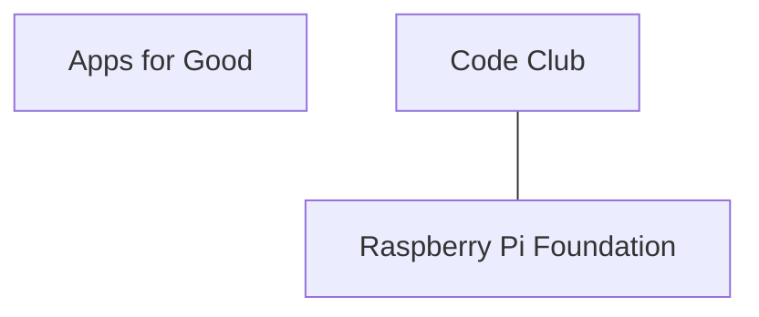
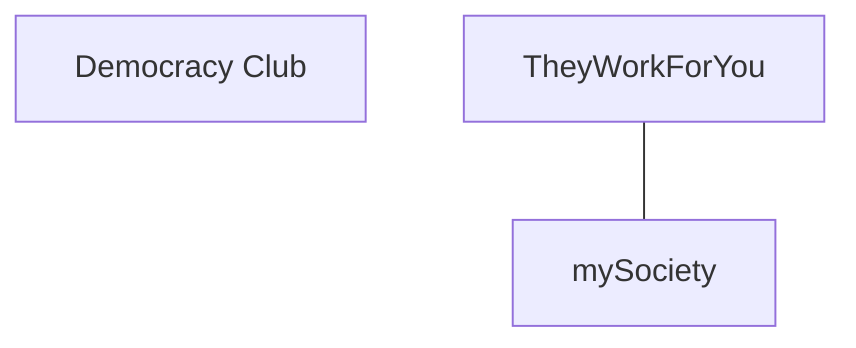

# UK Tech-for-Good Guide

This is a living directory of UK organisations, projects, networks, and people who use technology for public good: open data, civic tech, climate tech, accessibility, digital inclusion, humanitarian response, and more.

**Who this is for:** people looking for UK tech-for-good groups to work with, volunteer with, learn from, or connect to each other.

**How this guide is built:** it's generated from the YAML entries in `data/entries/`. Accuracy comes first: an entry is only added once its website (or another reliable source) confirms the details. This is a work in progress. It will grow, and some links or details may go out of date over time. See [CONTRIBUTING.md](CONTRIBUTING.md) to add or fix an entry.

## How to read this

Entries are grouped by **domain**: the area of public good the organisation works in. Each entry is a short, plain-language block: what the organisation does, where it's based, its links, and its tags. Where two entries are linked (for example, one runs on another's data, or they grew out of the same network), that connection is shown as a line in the diagrams below. No connection is invented: a line only appears if it's recorded in the underlying data.

**Legend: domains in this guide**

- **Open Data** (open-data): 8 entries
- **Education Equity Tech** (education equity tech): 3 entries
- **Human Rights Tech** (human-rights tech): 4 entries
- **Legal Aid & Justice Tech** (legal-aid / justice tech): 1 entry
- **Worker & Platform Co-ops** (worker-coop / platform-coop tech): 1 entry
- **Housing & Homelessness Tech** (housing / homelessness tech): 3 entries
- **Civic Tech** (civic-tech): 3 entries
- **Journalism & Media Tech** (journalism / media-tech): 1 entry
- **Digital Inclusion** (digital-inclusion): 1 entry
- **GovTech** (govtech): 2 entries
- **Green & Climate Tech** (green / climate-tech): 3 entries
- **Research & Education Tech** (research / education tech): 1 entry
- **Disability & Accessibility Tech** (disability & accessibility tech): 2 entries
- **Financial Inclusion & Fintech for Good** (financial-inclusion / fintech-for-good): 1 entry

**Total entries: 34, across 14 domains.**

## Ecosystem overview

This diagram shows the domains as nodes, sized by how many entries each holds, with a line drawn between two domains whenever at least one entry in one domain lists an entry in the other as related. Domains with no cross-domain links are shown on their own.

### Domain close-ups

The domains below have enough internal connections to be worth zooming in on. Isolated entries (no recorded links) are included as standalone nodes so the diagram still shows the whole domain.

**Education Equity Tech**

**Civic Tech**

## Open Data

Government or organisational data published for anyone to use, and the platforms that host and serve it.

_8 entries in this domain._

**360Giving**

- 360Giving is an UK charity that helps grantmakers publish and use open grants data through the 360Giving Data Standard and GrantNav. It is now part of Funders Together.
- Region: national
- Links: [Website](https://www.threesixtygiving.org) · [GitHub](https://github.com/threesixtygiving) · [LinkedIn](https://www.linkedin.com/company/360giving/)
- Tags: grants, open data, philanthropy, transparency

**Centre for Public Data**

- The Centre for Public Data is a non-profit, non-partisan advocacy organisation working for stronger public data: data collected, published or regulated by government. It works with policymakers, parliamentarians and organisations to identify data gaps and improve legislation.
- Region: national
- Links: [Website](https://www.centreforpublicdata.org) · [GitHub](https://github.com/centreforpublicdata) · [LinkedIn](https://www.linkedin.com/company/centreforpublicdata/)
- Tags: public data, policy, campaigning, legislation

**data.gov.uk**

- Data.gov.uk is the UK government's public data catalogue, now being transformed into the National Data Library. It is run by GDS in the Department for Science, Innovation and Technology and still hosts the directory where public bodies publish datasets.
- Region: national
- Links: [Website](https://www.data.gov.uk)
- Tags: open data, government, catalogue, datasets

**Office for National Statistics**

- Office for National Statistics is the UK's national statistical institute and largest independent producer of official statistics. It publishes over 600 releases a year on the economy, society and population.
- Region: national
- Links: [Website](https://www.ons.gov.uk) · [GitHub](https://github.com/ONSdigital) · [LinkedIn](https://www.linkedin.com/company/office-for-national-statistics)
- Tags: official statistics, open data, government, population

**Open Data Institute**

- Open Data Institute is a london-based non-profit founded in 2012 by Sir Tim Berners-Lee and Sir Nigel Shadbolt. It works on data infrastructure, research, policy, consultancy and training to build trust in data.
- Region: london
- Links: [Website](https://theodi.org) · [GitHub](https://github.com/theodi)
- Tags: open data, research, policy, data ethics

**Open Data Manchester**

- Open Data Manchester helps people, organisations and communities use data better through advice, advocacy, events, research and training.
- Region: north-west
- Links: [Website](https://www.opendatamanchester.org.uk) · [GitHub](https://github.com/OpenDataManchester)
- Tags: open data, training, community, greater manchester

**Open Innovations**

- Open Innovations was a Leeds-based not-for-profit open-data organisation. It stopped taking new work in May 2026 and its tools, data and blog remain online as an archive.
- Region: yorkshire-and-the-humber
- Links: [Website](https://open-innovations.org) · [GitHub](https://github.com/open-innovations)
- Tags: open data, leeds, visualisation, innovation

**OpenUK**

- OpenUK is a not-for-profit convening UK business, academia and technologists across open source, open hardware, open data, open standards and AI openness.
- Region: national
- Links: [Website](https://openuk.uk) · [LinkedIn](https://www.linkedin.com/company/openuk)
- Tags: open source, open standards, open data, advocacy

## Education Equity Tech

Tech that closes gaps in education: devices, coding programmes, and digital skills training for learners who wouldn't otherwise get them.

_3 entries in this domain._

**Apps for Good**

- Apps for Good is a UK education charity providing free computing, AI and essential-skills courses for schools. Its new AI for Good 2.0 course has students build AI-powered apps for social impact.
- Region: national
- Links: [Website](https://www.appsforgood.org) · [LinkedIn](https://www.linkedin.com/company/cdi-apps-for-good)
- Tags: education, courses, young people, digital skills

**Code Club**

- Code Club is a global network of free coding clubs for young people and part of the Raspberry Pi Foundation. It provides projects, training and support for the volunteers who run clubs.
- Region: national
- Links: [Website](https://codeclub.org) · [LinkedIn](https://uk.linkedin.com/company/code-club)
- Tags: coding, clubs, young people, volunteers
- Related: Raspberry Pi Foundation

**Raspberry Pi Foundation**

- Raspberry Pi Foundation is a UK charity that helps young people realise their potential through computing and digital technologies, publishing free learning resources and supporting clubs, teachers and Coolest Projects.
- Region: national
- Links: [Website](https://www.raspberrypi.org) · [LinkedIn](https://www.linkedin.com/company/raspberrypifoundation/)
- Tags: computing, education, young people, charity

## Human Rights Tech

Digital campaigning, advocacy, and organising tools used to defend and advance human rights.

_4 entries in this domain._

**Big Brother Watch**

- Big Brother Watch is a UK civil liberties campaign group focused on privacy, surveillance, facial recognition and free speech.
- Region: national
- Links: [Website](https://bigbrotherwatch.org.uk)
- Tags: privacy, civil liberties, surveillance, campaigning

**Liberty**

- Liberty is a UK civil liberties organisation that campaigns, litigates and advocates on human rights, including privacy, surveillance and free expression.
- Region: national
- Links: [Website](https://www.libertyhumanrights.org.uk) · [LinkedIn](https://www.linkedin.com/company/liberty-national-council-for-civil-liberties-/)
- Tags: civil liberties, human rights, litigation, campaigning

**Open Rights Group**

- Open Rights Group is a UK grassroots digital rights campaigning organisation working to protect privacy and free speech online. It campaigns on surveillance, data protection, AI and the effects of technology on people's rights.
- Region: national
- Links: [Website](https://www.openrightsgroup.org) · [LinkedIn](https://www.linkedin.com/company/open-rights-group/)
- Tags: digital rights, privacy, free speech, campaigning

**Privacy International**

- Privacy International is a London-based charity working on technology and human rights, with a focus on surveillance and the exploitation of personal data. It has worked on privacy since 1990.
- Region: london
- Links: [Website](https://privacyinternational.org)
- Tags: privacy, surveillance, human rights, research

## Legal Aid & Justice Tech

Free or low-cost legal information and tools that help people understand and exercise their legal rights without a lawyer.

_1 entry in this domain._

**Citizens Advice**

- Citizens Advice is a national charity giving free, independent advice on benefits, debt, housing, employment, consumer and legal problems through its website and a network of local offices.
- Region: national
- Links: [Website](https://www.citizensadvice.org.uk)
- Tags: advice, benefits, debt, legal

## Worker & Platform Co-ops

Technology built and owned cooperatively by the people who use or work on it, rather than by outside shareholders.

_1 entry in this domain._

**CoTech**

- CoTech is a UK-wide network of worker-owned technology and digital service cooperatives. It was founded at Wortley Hall in 2016 and became the first sector-specific arm of the workers.coop federation in September 2024.
- Region: national
- Links: [Website](https://www.coops.tech)
- Tags: co-operatives, worker ownership, software, network

## Housing & Homelessness Tech

Tools and data systems that help people find housing, coordinate homelessness services, or understand their rights as tenants.

_3 entries in this domain._

**Crisis**

- Crisis is a national UK charity for people experiencing homelessness, running services and campaigning for the policy changes needed to end homelessness.
- Region: national
- Links: [Website](https://www.crisis.org.uk) · [LinkedIn](https://www.linkedin.com/company/crisis)
- Tags: homelessness, housing, charity, campaigning

**Homeless Link**

- Homeless Link is a national membership charity for organisations working with people who become homeless in England, providing training, consultancy, data and policy advocacy.
- Region: national
- Links: [Website](https://homelesslink.org.uk) · [LinkedIn](https://www.linkedin.com/company/homeless-link)
- Tags: homelessness, housing, membership, policy

**Shelter England**

- Shelter England is a housing and homelessness charity in England providing advice, legal support and emergency helpline services, and campaigning for housing policy change.
- Region: national
- Links: [Website](https://england.shelter.org.uk) · [LinkedIn](https://www.linkedin.com/company/shelter-uk)
- Tags: housing, homelessness, advice, campaigning

## Civic Tech

Tools that help people take part in how their communities and government work: petitions, submissions, participatory budgeting, and ways to hold decision-makers to account.

_3 entries in this domain._

**Democracy Club**

- Democracy Club is a non-partisan UK community interest company that produces election data, runs WhoCanIVoteFor and WhereDoIVote, and publishes candidate and polling-station data for reuse.
- Region: national
- Links: [Website](https://democracyclub.org.uk) · [GitHub](https://github.com/DemocracyClub) · [LinkedIn](https://www.linkedin.com/company/democracy-club-cic)
- Tags: elections, open data, civic tech, voting

**mySociety**

- MySociety is a UK charity, established in 2003, that builds and runs digital services such as FixMyStreet, TheyWorkForYou and WhatDoTheyKnow to help people participate in civic life and hold institutions to account.
- Region: national
- Links: [Website](https://www.mysociety.org) · [GitHub](https://github.com/mysociety) · [LinkedIn](https://www.linkedin.com/company/mysociety)
- Tags: civic tech, democracy, research, open source

**TheyWorkForYou**

- TheyWorkForYou is a mySociety civic-tech service that makes Hansard, votes and representatives searchable across the UK's parliaments.
- Region: national
- Links: [Website](https://www.theyworkforyou.com) · [GitHub](https://github.com/mysociety/theyworkforyou)
- Tags: parliament, transparency, civic tech, hansard
- Related: mySociety

## Journalism & Media Tech

Public-interest journalism and the platforms or funding that support independent, accountable reporting.

_1 entry in this domain._

**Full Fact**

- Full Fact is an independent UK fact-checking charity that checks claims made online and in public debate, and works with platforms, regulators and researchers to reduce harm from bad information.
- Region: national
- Links: [Website](https://fullfact.org) · [GitHub](https://github.com/fullfact)
- Tags: fact checking, misinformation, journalism, research

## Digital Inclusion

Helping people who are shut out of the digital world get online, get devices, and build the skills and confidence to use them.

_1 entry in this domain._

**Good Things Foundation**

- Good Things Foundation is a UK digital inclusion charity running the National Digital Inclusion Network, National Databank, National Device Bank, Learn My Way and the AI Gateway.
- Region: national
- Links: [Website](https://www.goodthingsfoundation.org) · [GitHub](https://github.com/goodthingsfoundation) · [LinkedIn](https://www.linkedin.com/company/good-things-foundation)
- Tags: digital inclusion, digital skills, devices, charity

## GovTech

Software and data services built for or by government agencies, used to run public services or open government data to the public.

_2 entries in this domain._

**Government Digital Service**

- The Government Digital Service is the UK government's digital centre, building and setting standards for public services including GOV.UK, GOV.UK One Login and GOV.UK Pay.
- Region: national
- Links: [Website](https://www.gov.uk/government/organisations/government-digital-service) · [LinkedIn](https://www.linkedin.com/company/government-digital-service)
- Tags: govtech, public services, standards, digital government

**LocalGov Digital**

- LocalGov Digital is a network for digital practitioners working in and around UK local government, with more than 3,000 members. It runs an online community, events and shared resources for councils.
- Region: national
- Links: [Website](https://localgov.digital)
- Tags: local government, govtech, network, councils

## Green & Climate Tech

Tools that measure, reduce, or help people respond to climate change and its effects, from carbon tracking to clean-energy platforms.

_3 entries in this domain._

**Green Web Foundation**

- Green Web Foundation is a Dutch non-profit working towards a fossil-free internet by 2030. It maintains an open dataset of websites running on green energy and builds tools including CO2.js and carbon.txt.
- Region: national
- Links: [Website](https://www.thegreenwebfoundation.org) · [GitHub](https://github.com/thegreenwebfoundation) · [LinkedIn](https://nl.linkedin.com/company/green-web-foundation)
- Tags: climate, green hosting, dataset, internet

**Open Climate Fix**

- Open Climate Fix is a non-profit building open-source machine-learning forecasts for solar, wind, and cloud movements so electricity grids can use more renewable power. Its GB solar forecast is used by the National Energy System Operator.
- Region: national
- Links: [Website](https://openclimatefix.org) · [GitHub](https://github.com/openclimatefix) · [LinkedIn](https://www.linkedin.com/company/open-climate-fix)
- Tags: climate, machine learning, forecasting, energy

**The Restart Project**

- The Restart Project is a people-powered social enterprise running community repair events, Fixing Factories and repair directories. It campaigns for the right to repair.
- Region: national
- Links: [Website](https://therestartproject.org) · [GitHub](https://github.com/TheRestartProject) · [LinkedIn](https://www.linkedin.com/company/the-restart-project)
- Tags: right to repair, electronics, waste, community

## Research & Education Tech

Research institutions and platforms studying or supporting technology's role in society, and education programmes about it.

_1 entry in this domain._

**OpenSAFELY**

- OpenSAFELY is a platform for analysing sensitive NHS records safely, built and maintained by the Bennett Institute at the University of Oxford with NHS England, TPP, Optum and collaborators.
- Region: national
- Links: [Website](https://www.opensafely.org)
- Tags: health data, research, privacy, open source

## Disability & Accessibility Tech

Tools and consultancy that make websites, services, and physical spaces usable by disabled people, and organisations advocating for that.

_2 entries in this domain._

**RNIB**

- RNIB is the UK's leading sight loss charity, providing practical and emotional support to blind and partially sighted people and campaigning for accessible products and services. It also runs specialist services including Talking Books and RNIB Connect Radio.
- Region: national
- Links: [Website](https://www.rnib.org.uk) · [GitHub](https://github.com/rnib) · [LinkedIn](https://www.linkedin.com/company/rnib)
- Tags: accessibility, blindness, assistive technology, charity

**Scope**

- Scope is a disability equality charity in England and Wales providing practical information, support, and campaigns on the barriers disabled people face. It runs a helpline, disability energy service, and charity shops.
- Region: national
- Links: [Website](https://www.scope.org.uk) · [LinkedIn](https://uk.linkedin.com/company/scope)
- Tags: disability, equality, accessibility, charity

## Financial Inclusion & Fintech for Good

Tools that help people who are excluded from mainstream banking manage money, build savings, or access fair credit.

_1 entry in this domain._

**Turn2us**

- Turn2us is a UK charity helping people facing financial insecurity. It runs a benefits calculator, a charitable grants search and direct grant programmes, and says its roots stretch back to 1897.
- Region: national
- Links: [Website](https://www.turn2us.org.uk) · [LinkedIn](https://www.linkedin.com/company/turn2us/)
- Tags: financial insecurity, benefits, grants, charity

## How this is maintained / how to add an entry

This guide is generated from the YAML files in `data/entries/`, one file per entry. See [CONTRIBUTING.md](CONTRIBUTING.md) for the full step-by-step walkthrough. In short:

1. Copy `data/entry.template.yaml` to `data/entries/<slug>.yaml`.
2. Fill in the fields, verifying each against a live source.
3. Run `python3 scripts/validate.py` to check it against the schema.
4. Run `python3 scripts/build_guide.py` to regenerate this file, then open a pull request.

Entries are only added once verified against a live source. If you spot something out of date, check the entry's `source` field first, then update the YAML file in `data/entries/`.

