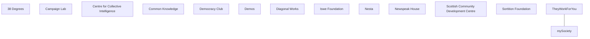
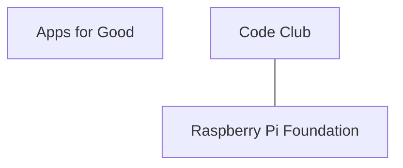

# UK Tech-for-Good Guide

This is a living directory of UK organisations, projects, networks, and people who use technology for public good: open data, civic tech, climate tech, accessibility, digital inclusion, humanitarian response, and more.

**Who this is for:** people looking for UK tech-for-good groups to work with, volunteer with, learn from, or connect to each other.

**How this guide is built:** it's generated from the YAML entries in `data/entries/`. Accuracy comes first: an entry is only added once its website (or another reliable source) confirms the details. This is a work in progress. It will grow, and some links or details may go out of date over time. See [CONTRIBUTING.md](CONTRIBUTING.md) to add or fix an entry.

## How to read this

Entries are grouped by **domain**: the area of public good the organisation works in. Each entry is a short, plain-language block: what the organisation does, where it's based, its links, and its tags. Where two entries are linked (for example, one runs on another's data, or they grew out of the same network), that connection is shown as a line in the diagrams below. No connection is invented: a line only appears if it's recorded in the underlying data.

**Legend: domains in this guide**

- **Open Data** (open-data): 13 entries
- **Civic Tech** (civic-tech): 14 entries
- **Tech Ethics & Responsible AI** (tech-ethics / responsible-AI): 9 entries
- **Education Equity Tech** (education equity tech): 3 entries
- **Journalism & Media Tech** (journalism / media-tech): 4 entries
- **Human Rights Tech** (human-rights tech): 14 entries
- **Crisis & Humanitarian Tech** (crisis / humanitarian-tech): 3 entries
- **Nonprofit & NGO Tech** (nonprofit / NGO tech): 3 entries
- **Legal Aid & Justice Tech** (legal-aid / justice tech): 1 entry
- **GovTech** (govtech): 10 entries
- **Green & Climate Tech** (green / climate-tech): 5 entries
- **Worker & Platform Co-ops** (worker-coop / platform-coop tech): 1 entry
- **Housing & Homelessness Tech** (housing / homelessness tech): 3 entries
- **Research & Education Tech** (research / education tech): 8 entries
- **Digital Inclusion** (digital-inclusion): 2 entries
- **Environmental Citizen Science** (environmental citizen-science): 4 entries
- **Disability & Accessibility Tech** (disability & accessibility tech): 2 entries
- **Financial Inclusion & Fintech for Good** (financial-inclusion / fintech-for-good): 1 entry

**Total entries: 100, across 18 domains.**

## Ecosystem overview

This diagram shows the domains as nodes, sized by how many entries each holds, with a line drawn between two domains whenever at least one entry in one domain lists an entry in the other as related. Domains with no cross-domain links are shown on their own.

### Domain close-ups

The domains below have enough internal connections to be worth zooming in on. Isolated entries (no recorded links) are included as standalone nodes so the diagram still shows the whole domain.

**Civic Tech**

**Education Equity Tech**

## Open Data

Government or organisational data published for anyone to use, and the platforms that host and serve it.

_13 entries in this domain._

**360Giving**

- 360Giving is an UK charity that helps grantmakers publish and use open grants data through the 360Giving Data Standard and GrantNav. It is now part of Funders Together.
- Region: national
- Links: [Website](https://www.threesixtygiving.org) · [GitHub](https://github.com/threesixtygiving) · [LinkedIn](https://www.linkedin.com/company/360giving/)
- Tags: grants, open data, philanthropy, transparency

**Centre for Public Data**

- The Centre for Public Data is a non-profit, non-partisan advocacy organisation working for stronger public data: data collected, published or regulated by government. It works with policymakers, parliamentarians and organisations to identify data gaps and improve legislation.
- Region: national
- Links: [Website](https://www.centreforpublicdata.org) · [GitHub](https://github.com/centreforpublicdata) · [LinkedIn](https://www.linkedin.com/company/centreforpublicdata/)
- Tags: public data, policy, campaigning, legislation

**CoST Infrastructure Transparency Initiative**

- CoST is a global non-profit that works with governments and civil society to publish and validate data on public infrastructure projects. It uses that data to improve transparency, accountability and participation in infrastructure investment.
- Region: london
- Links: [Website](https://infrastructuretransparency.org) · [LinkedIn](https://www.linkedin.com/company/8505009/)
- Tags: infrastructure, transparency, open data, accountability

**data.gov.uk**

- Data.gov.uk is the UK government's public data catalogue, now being transformed into the National Data Library. It is run by GDS in the Department for Science, Innovation and Technology and still hosts the directory where public bodies publish datasets.
- Region: national
- Links: [Website](https://www.data.gov.uk)
- Tags: open data, government, catalogue, datasets

**International Aid Transparency Initiative**

- The International Aid Transparency Initiative is a global initiative that publishes data on development and humanitarian spending using the IATI Standard. It provides free tools and guidance so that aid information is open and usable.
- Region: scotland
- Links: [Website](https://iatistandard.org/en/) · [Events](https://iatistandard.org/en/events/)
- Tags: aid transparency, open data, international development, standards

**Office for National Statistics**

- Office for National Statistics is the UK's national statistical institute and largest independent producer of official statistics. It publishes over 600 releases a year on the economy, society and population.
- Region: national
- Links: [Website](https://www.ons.gov.uk) · [GitHub](https://github.com/ONSdigital) · [LinkedIn](https://www.linkedin.com/company/office-for-national-statistics)
- Tags: official statistics, open data, government, population

**Open Data Institute**

- Open Data Institute is a london-based non-profit founded in 2012 by Sir Tim Berners-Lee and Sir Nigel Shadbolt. It works on data infrastructure, research, policy, consultancy and training to build trust in data.
- Region: london
- Links: [Website](https://theodi.org) · [GitHub](https://github.com/theodi)
- Tags: open data, research, policy, data ethics

**Open Data Manchester**

- Open Data Manchester helps people, organisations and communities use data better through advice, advocacy, events, research and training.
- Region: north-west
- Links: [Website](https://www.opendatamanchester.org.uk) · [GitHub](https://github.com/OpenDataManchester)
- Tags: open data, training, community, greater manchester

**Open Data Services**

- Open Data Services is a worker-owned consultancy that helps governments, charities and international institutions publish and use open data. It works on data standards, governance, infrastructure and the tools that let organisations share information across boundaries.
- Region: north-west
- Links: [Website](https://ods.coop/) · [GitHub](https://github.com/OpenDataServices/) · [LinkedIn](https://www.linkedin.com/company/9493272)
- Tags: open data, data standards, worker co-op, public good

**Open Innovations**

- Open Innovations was a Leeds-based not-for-profit open-data organisation. It stopped taking new work in May 2026 and its tools, data and blog remain online as an archive.
- Region: yorkshire-and-the-humber
- Links: [Website](https://open-innovations.org) · [GitHub](https://github.com/open-innovations)
- Tags: open data, leeds, visualisation, innovation

**Open Knowledge Foundation**

- The Open Knowledge Foundation is a not-for-profit organisation that builds digital tools and infrastructure for open data and open knowledge. It runs projects including CKAN, Open Data Day and the Open Data Editor, and supports a global network of open knowledge communities.
- Region: national
- Links: [Website](https://okfn.org/en/) · [GitHub](https://github.com/okfn) · [LinkedIn](https://www.linkedin.com/company/open-knowledge-foundation/)
- Tags: open data, open knowledge, digital public goods, civic tech

**Open Ownership**

- Open Ownership is a non-profit that helps governments publish and use high-quality data about who owns companies and other legal entities. It promotes beneficial ownership transparency to reduce corruption and tax evasion and supports the global Open Ownership data standard.
- Region: national
- Links: [Website](https://www.openownership.org/en/) · [GitHub](https://github.com/openownership/) · [LinkedIn](https://www.linkedin.com/company/openownership/) · [Events](https://www.openownership.org/en/publication-categories/events/)
- Tags: open data, beneficial ownership, transparency, anti-corruption

**OpenUK**

- OpenUK is a not-for-profit convening UK business, academia and technologists across open source, open hardware, open data, open standards and AI openness.
- Region: national
- Links: [Website](https://openuk.uk) · [LinkedIn](https://www.linkedin.com/company/openuk)
- Tags: open source, open standards, open data, advocacy

## Civic Tech

Tools that help people take part in how their communities and government work: petitions, submissions, participatory budgeting, and ways to hold decision-makers to account.

_14 entries in this domain._

**38 Degrees**

- 38 Degrees is a UK campaigning organisation whose members start and sign petitions and take action on political and social issues. It provides campaigning tools and staff support for member-led campaigns.
- Region: national
- Links: [Website](https://home.38degrees.org.uk/) · [LinkedIn](https://uk.linkedin.com/company/38-degrees)
- Tags: campaigning, petitions, civic engagement

**Campaign Lab**

- Campaign Lab is a network of campaigners, data scientists, researchers and technologists who build and test digital tools for progressive political campaigns. It runs hack nights, experiments and research to improve how campaigns use data and technology.
- Region: london
- Links: [Website](https://campaignlab.uk/) · [LinkedIn](https://www.linkedin.com/company/campaign-lab-uk) · [Events](https://campaignlab.uk/events/)
- Tags: civic tech, campaigning, elections, research, volunteering

**Centre for Collective Intelligence**

- The Centre for Collective Intelligence is a Nesta project that helps public and voluntary sector organisations involve citizens in decisions on complex issues. It designs digital tools and deliberative engagements, using technology, AI, arts and design to scale public participation.
- Region: london
- Links: [Website](https://www.nesta.org.uk/centre-for-collective-intelligence/)
- Tags: collective intelligence, public engagement, ai, civic tech

**Common Knowledge**

- Common Knowledge is a not-for-profit worker cooperative of technologists, designers, researchers and facilitators. It builds digital tools and provides training and strategic advice to help grassroots organisers and communities increase their impact.
- Region: london
- Links: [Website](https://commonknowledge.coop/) · [GitHub](https://github.com/commonknowledge) · [LinkedIn](https://www.linkedin.com/company/commonknowledge)
- Tags: worker cooperative, digital infrastructure, organising, civic tech

**Democracy Club**

- Democracy Club is a non-partisan UK community interest company that produces election data, runs WhoCanIVoteFor and WhereDoIVote, and publishes candidate and polling-station data for reuse.
- Region: national
- Links: [Website](https://democracyclub.org.uk) · [GitHub](https://github.com/DemocracyClub) · [LinkedIn](https://www.linkedin.com/company/democracy-club-cic)
- Tags: elections, open data, civic tech, voting

**Demos**

- Demos is an independent educational charity and cross-party think tank working on democracy and public policy. Its Demos Digital work and participatory research use technology to involve citizens in policy making.
- Region: london
- Links: [Website](https://demos.co.uk) · [LinkedIn](https://www.linkedin.com/company/demos_2) · [Events](https://demos.co.uk/events/)
- Tags: democracy, think tank, research, participatory tech

**Diagonal Works**

- Diagonal Works is a steward-owned data science and visualisation consultancy that builds software tools for understanding urban systems. It uses open data to help planners, public agencies and developers assess how changes to a city may affect people and places.
- Region: national
- Links: [Website](https://diagonal.works/)
- Tags: urban planning, open data, data visualisation, cities

**Iswe Foundation**

- Iswe Foundation is an independent not-for-profit innovation centre working on participatory political systems. It runs Assemblis, an online platform that gives communities tools to run local assemblies.
- Region: south-west
- Links: [Website](https://www.iswe.org/) · [LinkedIn](https://www.linkedin.com/company/iswe-foundation)
- Tags: democracy, citizen assemblies, participation, civic tech

**mySociety**

- MySociety is a UK charity, established in 2003, that builds and runs digital services such as FixMyStreet, TheyWorkForYou and WhatDoTheyKnow to help people participate in civic life and hold institutions to account.
- Region: national
- Links: [Website](https://www.mysociety.org) · [GitHub](https://github.com/mysociety) · [LinkedIn](https://www.linkedin.com/company/mysociety)
- Tags: civic tech, democracy, research, open source

**Nesta**

- Nesta is a research and innovation foundation that designs, tests and scales solutions to social challenges. Its work includes collective intelligence, data visualisation and policy research.
- Region: national
- Links: [Website](https://www.nesta.org.uk/) · [LinkedIn](https://www.linkedin.com/company/nesta)
- Tags: innovation, research, social good, data

**Newspeak House**

- Newspeak House is an independent residential college in London that studies and supports communities of practice across civil society and the public sector. It runs a fellowship programme and hosts hackathons, meetups and lectures on political technology and digital infrastructure.
- Region: london
- Links: [Website](https://newspeak.house/) · [Events](https://newspeak.house/events)
- Tags: civic tech, political technology, education, events

**Scottish Community Development Centre**

- The Scottish Community Development Centre is a charity and the national lead body for community development in Scotland. It supports community groups and public bodies with training, research and the VOiCE community engagement software.
- Region: scotland
- Links: [Website](https://www.scdc.org.uk/) · [LinkedIn](https://www.linkedin.com/company/the-scottish-community-development-centre)
- Tags: community development, scotland, charity, community engagement

**Sortition Foundation**

- Sortition Foundation promotes citizens' assemblies and runs democratic lotteries to select representative groups of people. It uses its Open Democratic Lottery Platform to help governments, councils and community groups organise deliberative processes.
- Region: south-west
- Links: [Website](https://www.sortitionfoundation.org/)
- Tags: democracy, citizens assemblies, sortition, civic tech

**TheyWorkForYou**

- TheyWorkForYou is a mySociety civic-tech service that makes Hansard, votes and representatives searchable across the UK's parliaments.
- Region: national
- Links: [Website](https://www.theyworkforyou.com) · [GitHub](https://github.com/mysociety/theyworkforyou)
- Tags: parliament, transparency, civic tech, hansard
- Related: mySociety

## Tech Ethics & Responsible AI

Groups working on the ethical, safe, and accountable use of technology and AI, including policy research and public education.

_9 entries in this domain._

**Ada Lovelace Institute**

- The Ada Lovelace Institute is an independent research institute focused on data and AI. It conducts research, policy and practice work to ensure the benefits of data and AI are distributed fairly.
- Region: london
- Links: [Website](https://www.adalovelaceinstitute.org/) · [LinkedIn](https://www.linkedin.com/company/ada-lovelace-institute) · [Events](https://www.adalovelaceinstitute.org/news-events/events/)
- Tags: ai, data policy, research, responsible ai

**AI Security Institute**

- The AI Security Institute is a UK government research organisation that tests advanced AI systems and studies their risks. It provides technical evidence to help governments keep the public safe.
- Region: london
- Links: [Website](https://www.aisi.gov.uk/) · [LinkedIn](https://www.linkedin.com/company/ai-security-institute?trk=public_post_feed-actor-name)
- Tags: ai safety, government, research, risk

**Cassandra Foundation**

- Cassandra Foundation is an independent policy research organisation studying the economic effects of artificial intelligence and the policies needed for a fair transition. It publishes evidence papers and simulations on AI, work and public services.
- Region: london
- Links: [Website](https://cassandrafoundation.com/)
- Tags: ai policy, responsible ai, research, labour markets

**Citizens' Track on AI**

- The Citizens' Track on AI is an initiative that brings public deliberation and community assemblies into international AI governance. It connects local participatory processes with global governance forums so affected communities can shape decisions about AI.
- Region: national
- Links: [Website](https://citizens-track.org/2026/report/) · [Events](https://citizens-track.org/events/)
- Tags: ai governance, public participation, deliberation, civic tech

**Connected by Data**

- Connected by Data is a not-for-profit organisation that campaigns for communities to have a powerful say in decisions about data and AI. It runs networks, events and research on participatory data governance.
- Region: south-east
- Links: [Website](https://connectedbydata.org/) · [LinkedIn](https://www.linkedin.com/company/connectedbydata) · [Community](https://discord.gg/uZyhRghzsc) · [Events](https://connectedbydata.org/events)
- Tags: data governance, ai, public participation, civil society

**Cooperative AI Foundation**

- The Cooperative AI Foundation is a charity that supports research to improve cooperation among advanced AI systems for public benefit. It funds researchers and runs workshops and summer schools on cooperative AI.
- Region: south-west
- Links: [Website](https://www.cooperativeai.com/) · [LinkedIn](https://www.linkedin.com/company/coop-ai/) · [Events](https://www.cooperativeai.com/events)
- Tags: ai, research, cooperation, ai safety

**Institute for the Future of Work**

- The Institute for the Future of Work is an independent research institute studying how new technologies change work and society. It produces research and policy work on responsible AI, automation and good work.
- Region: london
- Links: [Website](https://www.ifow.org/) · [LinkedIn](https://www.linkedin.com/company/institute-future-work/) · [Events](https://www.ifow.org/events)
- Tags: future of work, responsible ai, research, policy, automation

**Oversight Board**

- The Oversight Board is an independent body that reviews Meta's content moderation decisions on Facebook, Instagram and Threads. It makes binding decisions on difficult cases and publishes policy recommendations on free expression, human rights and platform governance.
- Region: london
- Links: [Website](https://www.oversightboard.com/) · [LinkedIn](https://www.linkedin.com/company/oversight-board-administration/) · [Events](https://www.oversightboard.com/events/)
- Tags: content moderation, platform governance, human rights, responsible tech

**Worker Info Exchange**

- Worker Info Exchange is a non-profit that helps workers reclaim control over data collected from them at work. It uses data access requests, investigations and data trusts to challenge algorithmic management and support legal claims.
- Region: london
- Links: [Website](https://www.workerinfoexchange.org/)
- Tags: workers, data rights, algorithmic accountability, gig economy

## Education Equity Tech

Tech that closes gaps in education: devices, coding programmes, and digital skills training for learners who wouldn't otherwise get them.

_3 entries in this domain._

**Apps for Good**

- Apps for Good is a UK education charity providing free computing, AI and essential-skills courses for schools. Its new AI for Good 2.0 course has students build AI-powered apps for social impact.
- Region: national
- Links: [Website](https://www.appsforgood.org) · [LinkedIn](https://www.linkedin.com/company/cdi-apps-for-good)
- Tags: education, courses, young people, digital skills

**Code Club**

- Code Club is a global network of free coding clubs for young people and part of the Raspberry Pi Foundation. It provides projects, training and support for the volunteers who run clubs.
- Region: national
- Links: [Website](https://codeclub.org) · [LinkedIn](https://uk.linkedin.com/company/code-club)
- Tags: coding, clubs, young people, volunteers
- Related: Raspberry Pi Foundation

**Raspberry Pi Foundation**

- Raspberry Pi Foundation is a UK charity that helps young people realise their potential through computing and digital technologies, publishing free learning resources and supporting clubs, teachers and Coolest Projects.
- Region: national
- Links: [Website](https://www.raspberrypi.org) · [LinkedIn](https://www.linkedin.com/company/raspberrypifoundation/)
- Tags: computing, education, young people, charity

## Journalism & Media Tech

Public-interest journalism and the platforms or funding that support independent, accountable reporting.

_4 entries in this domain._

**BBC Media Action**

- BBC Media Action is the BBC's international charity. It works with local partners to provide impartial media and information, and trains journalists in countries affected by conflict, disaster and disinformation.
- Region: london
- Links: [Website](https://www.bbc.co.uk/mediaaction) · [LinkedIn](https://www.linkedin.com/company/bbcmediaaction)
- Tags: media, journalism, disinformation, international development

**BBC Monitoring**

- BBC Monitoring is a BBC service that reports and analyses news from radio, television, press and online sources around the world. It provides media monitoring and open-source intelligence to subscribers.
- Region: london
- Links: [Website](https://monitoring.bbc.co.uk/)
- Tags: media monitoring, open source intelligence, journalism, public media

**Full Fact**

- Full Fact is an independent UK fact-checking charity that checks claims made online and in public debate, and works with platforms, regulators and researchers to reduce harm from bad information.
- Region: national
- Links: [Website](https://fullfact.org) · [GitHub](https://github.com/fullfact)
- Tags: fact checking, misinformation, journalism, research

**Global Disinformation Index**

- The Global Disinformation Index is a not-for-profit research organisation that maps the money behind disinformation and publishes data on how advertising and platforms fund harmful content. Its research is used by policymakers, regulators and industry to act on online harms.
- Region: london
- Links: [Website](https://www.disinformationindex.org/) · [LinkedIn](https://www.linkedin.com/company/the-global-disinformation-index)
- Tags: disinformation, media research, advertising, online harms

## Human Rights Tech

Digital campaigning, advocacy, and organising tools used to defend and advance human rights.

_14 entries in this domain._

**Big Brother Watch**

- Big Brother Watch is a UK civil liberties campaign group focused on privacy, surveillance, facial recognition and free speech.
- Region: national
- Links: [Website](https://bigbrotherwatch.org.uk)
- Tags: privacy, civil liberties, surveillance, campaigning

**Center for Countering Digital Harm**

- The Center for Countering Digital Harm is a non-profit research and advocacy organisation that investigates digital harm and holds technology companies accountable. It publishes research and runs campaigns for platform regulation and online safety.
- Region: london
- Links: [Website](https://www.counterharm.com/) · [LinkedIn](https://www.linkedin.com/company/center-for-countering-digital-hate)
- Tags: online safety, digital rights, platform accountability, disinformation

**Centre for Information Resilience**

- The Centre for Information Resilience is a non-profit social enterprise that uses open-source research and digital investigations to expose disinformation, human rights abuses and war crimes. It works with local partners and media to verify digital evidence from conflict zones.
- Region: national
- Links: [Website](https://www.info-res.org/) · [LinkedIn](https://www.linkedin.com/company/centre-for-information-resilience/)
- Tags: open source intelligence, disinformation, human rights, investigations

**Digital Action**

- Digital Action is a non-profit network that works with civil society partners to hold technology companies and governments accountable for digital threats to democracy and human rights. It builds coalitions and publishes research on issues including AI, online safety and women's rights online.
- Region: national
- Links: [Website](https://digitalaction.co/) · [LinkedIn](https://www.linkedin.com/company/digital-act/)
- Tags: digital rights, big tech accountability, democracy, research

**Foxglove**

- Foxglove is a non-profit community interest company that uses litigation, campaigning and communication to challenge abuses by technology companies and governments. Its cases and campaigns examine the use of technology in public services and the power of large technology companies.
- Region: london
- Links: [Website](https://www.foxglove.org.uk/)
- Tags: tech justice, litigation, campaigning, digital rights

**HateLab**

- HateLab is a research hub at Cardiff University that studies hate speech and hate crime. It uses data science and AI to measure online harm and supports organisations with tools for identifying threats.
- Region: wales
- Links: [Website](https://hatelab.net/)
- Tags: hate speech, hate crime, data science, online safety, research

**Liberty**

- Liberty is a UK civil liberties organisation that campaigns, litigates and advocates on human rights, including privacy, surveillance and free expression.
- Region: national
- Links: [Website](https://www.libertyhumanrights.org.uk) · [LinkedIn](https://www.linkedin.com/company/liberty-national-council-for-civil-liberties-/)
- Tags: civil liberties, human rights, litigation, campaigning

**Luminate**

- Luminate is a philanthropic foundation that funds organisations working for a fairer digital age. It supports digital rights, privacy, public interest media and technology policy work across Africa, Asia, Europe and Latin America.
- Region: london
- Links: [Website](https://luminategroup.com/) · [LinkedIn](https://www.linkedin.com/company/luminategroup/)
- Tags: digital rights, philanthropy, privacy, media

**Open Briefing**

- Open Briefing provides security and wellbeing support to activists, communities and movements at risk. It helps them strengthen their physical safety, digital resilience and collective wellbeing, and advises nonprofits and foundations on managing risk.
- Region: south-west
- Links: [Website](https://www.openbriefing.org/)
- Tags: human rights, digital security, activism, nonprofit support

**Open Rights Group**

- Open Rights Group is a UK grassroots digital rights campaigning organisation working to protect privacy and free speech online. It campaigns on surveillance, data protection, AI and the effects of technology on people's rights.
- Region: national
- Links: [Website](https://www.openrightsgroup.org) · [LinkedIn](https://www.linkedin.com/company/open-rights-group/)
- Tags: digital rights, privacy, free speech, campaigning

**Privacy International**

- Privacy International is a London-based charity working on technology and human rights, with a focus on surveillance and the exploitation of personal data. It has worked on privacy since 1990.
- Region: london
- Links: [Website](https://privacyinternational.org)
- Tags: privacy, surveillance, human rights, research

**Small Media**

- Small Media is a non-profit foundation that works to protect freedom of expression and access to information in politically closed societies. It carries out research, advocacy and training, and develops online resources to help human rights defenders work more safely.
- Region: london
- Links: [Website](https://smallmedia.org.uk/)
- Tags: digital rights, free expression, human rights, digital security

**Team CommUNITY**

- Team CommUNITY is a community network that supports digital rights defenders, civil society groups and journalists facing technology-related threats. It runs community spaces, a wiki, a job board and events to share knowledge and build cross-border solidarity.
- Region: london
- Links: [Website](https://www.digitalrights.community/) · [Events](https://wiki.digitalrights.community/index.php?title=Calendar_of_Events)
- Tags: digital rights, human rights, community network, digital security

**Whistleblowing International Network**

- The Whistleblowing International Network is an international charity based in Scotland that supports civil society organisations defending whistleblowers. It provides tools, expertise and a shared platform, and runs the EU Whistleblowing Monitor to track whistleblowing law across Europe.
- Region: scotland
- Links: [Website](https://whistleblowingnetwork.org/Home) · [LinkedIn](https://www.linkedin.com/company/whistleblowing-international-network/) · [Events](https://whistleblowingnetwork.org/News-Events/Events)
- Tags: whistleblowing, human rights, legal accountability, network

## Crisis & Humanitarian Tech

Technology used during emergencies and disasters: coordinating relief, sharing warnings, and helping people find help fast when it matters most.

_3 entries in this domain._

**British Red Cross**

- The British Red Cross is a humanitarian charity that helps people in the UK and overseas during conflicts, disasters and individual emergencies. It runs emergency response, health and care, first aid and refugee services, supported by in-house technology and digital teams.
- Region: national
- Links: [Website](https://www.redcross.org.uk/) · [LinkedIn](https://www.linkedin.com/company/british-red-cross)
- Tags: humanitarian, emergency response, health and care, first aid, refugees

**MapAction**

- MapAction is a non-profit organisation that provides mapping, geospatial and data expertise during humanitarian emergencies. It works with disaster response agencies to turn incoming data into maps and analysis that support decisions.
- Region: south-east
- Links: [Website](https://mapaction.org/) · [LinkedIn](https://www.linkedin.com/company/mapaction)
- Tags: humanitarian, mapping, geospatial, disaster response

**UK Humanitarian Innovation Hub (UKHIH)**

- The UK Humanitarian Innovation Hub is a UK-funded programme that brings government, science, private and humanitarian actors together. It supports innovations and technologies for humanitarian responses to disasters and conflict.
- Region: national
- Links: [Website](https://devtracker.fcdo.gov.uk/programme/GB-CHC-1177110-UKHIH/summary)
- Tags: humanitarian, innovation, disaster response, government

## Nonprofit & NGO Tech

Software, consultancies, and infrastructure built specifically to serve nonprofits and NGOs.

_3 entries in this domain._

**CAST**

- CAST is a charity that helps UK charities and social impact organisations use digital and AI. It provides free learning, resources and peer groups to build digital knowledge and confidence.
- Region: national
- Links: [Website](https://www.wearecast.org.uk/) · [LinkedIn](https://www.linkedin.com/company/cast-centre-for-the-acceleration-of-social-technology)
- Tags: charity, digital skills, ai, nonprofit tech

**DataKind UK**

- DataKind UK is a charity that helps other third sector organisations use data analysis and data science. It matches charities and social enterprises with skilled data volunteers and runs free projects, resources and events.
- Region: national
- Links: [Website](https://www.datakind.org.uk) · [GitHub](https://github.com/DataKind-UK) · [LinkedIn](https://www.linkedin.com/company/datakind-uk/) · [Events](https://www.datakind.org.uk/events)
- Tags: data science, charity, volunteers, data for good

**The Developer Society**

- The Developer Society is a not-for-profit digital co-op that designs, builds and supports websites, digital services, data systems and responsible AI for charities and NGOs. It is a community benefit society run by its employees.
- Region: west-midlands
- Links: [Website](https://www.dev.ngo/) · [LinkedIn](https://www.linkedin.com/company/the-developer-society/)
- Tags: co-operative, charities, nonprofits, digital services, responsible ai

## Legal Aid & Justice Tech

Free or low-cost legal information and tools that help people understand and exercise their legal rights without a lawyer.

_1 entry in this domain._

**Citizens Advice**

- Citizens Advice is a national charity giving free, independent advice on benefits, debt, housing, employment, consumer and legal problems through its website and a network of local offices.
- Region: national
- Links: [Website](https://www.citizensadvice.org.uk)
- Tags: advice, benefits, debt, legal

## GovTech

Software and data services built for or by government agencies, used to run public services or open government data to the public.

_10 entries in this domain._

**CivTech Scotland**

- CivTech Scotland is a Scottish Government team that brings the public and private sectors together to build solutions to public sector problems. It runs challenge rounds in which individuals, companies and organisations build new products with public bodies.
- Region: scotland
- Links: [Website](https://www.civtech.scot/)
- Tags: scotland, govtech, public sector innovation, challenges

**DG Cities**

- DG Cities is a council-owned urban innovation company that helps local authorities adopt technology and data. Its projects cover digital inclusion, housing data, transport innovation and tools for meeting decarbonisation targets.
- Region: london
- Links: [Website](https://www.dgcities.com) · [LinkedIn](https://www.linkedin.com/company/dg-cities/)
- Tags: local government, smart cities, urban innovation, digital inclusion

**Government Digital Service**

- The Government Digital Service is the UK government's digital centre, building and setting standards for public services including GOV.UK, GOV.UK One Login and GOV.UK Pay.
- Region: national
- Links: [Website](https://www.gov.uk/government/organisations/government-digital-service) · [LinkedIn](https://www.linkedin.com/company/government-digital-service)
- Tags: govtech, public services, standards, digital government

**Justice Digital**

- Justice Digital is the Ministry of Justice's digital, data and science team. It builds and runs digital services and technology used across the justice system.
- Region: national
- Links: [Website](https://mojdigital.blog.gov.uk/) · [LinkedIn](https://www.linkedin.com/company/justice-digital/)
- Tags: justice, government, digital services, data

**LocalGov Digital**

- LocalGov Digital is a network for digital practitioners working in and around UK local government, with more than 3,000 members. It runs an online community, events and shared resources for councils.
- Region: national
- Links: [Website](https://localgov.digital)
- Tags: local government, govtech, network, councils

**MapIt UK**

- MapIt is a mySociety service that maps postcodes and locations to UK administrative boundaries. Its bulk tool adds council, constituency and other area columns to uploaded spreadsheets.
- Region: national
- Links: [Website](https://mapit.mysociety.org/bulk/) · [GitHub](https://github.com/mysociety/mapit)
- Tags: mapping, open data, local government, civic tech

**One Team Gov**

- One Team Gov is a global community of public sector reformers who meet online and in person to share practical ways to improve government services. Its UK network runs regular meetups and maintains a Slack community for civil servants, service designers and technologists.
- Region: national
- Links: [Website](https://oneteamgov.uk/) · [LinkedIn](https://www.linkedin.com/company/oneteamgov/posts/)
- Tags: govtech, public sector, peer network, service design

**Policy Lab**

- Policy Lab is a UK government team that works to improve policymaking through design, innovation and people-centred approaches. It runs practical projects and provides digital co-design resources for civil servants, local authorities and communities.
- Region: national
- Links: [Website](https://openpolicy.blog.gov.uk/) · [LinkedIn](https://www.linkedin.com/company/policy-lab-uk) · [Events](https://openpolicy.blog.gov.uk/category/events/)
- Tags: govtech, policy design, public sector innovation, co-design

**SocietyWorks**

- SocietyWorks is a not-for-profit social enterprise owned by the civic technology charity mySociety. It builds and runs open source digital services that help local authorities and other public bodies interact with citizens, including FixMyStreet Pro, WasteWorks and FOIWorks.
- Region: national
- Links: [Website](https://www.societyworks.org/)
- Tags: govtech, open source, local government, civic tech

**The National Archives**

- The National Archives is the UK Government's official archive and publisher for England and Wales. It preserves national records and gives the public online access to catalogues, digital archives and related government information services.
- Region: national
- Links: [Website](https://www.nationalarchives.gov.uk/) · [Events](https://www.nationalarchives.gov.uk/whats-on/)
- Tags: archives, public records, government, digital archive

## Green & Climate Tech

Tools that measure, reduce, or help people respond to climate change and its effects, from carbon tracking to clean-energy platforms.

_5 entries in this domain._

**Climate Emergency UK**

- Climate Emergency UK assesses all UK councils on the action they have taken towards net zero and publishes the results as the Council Climate Action Scorecards. It also trains and supports residents, councillors and council staff to campaign for faster local climate action.
- Region: national
- Links: [Website](https://climateemergency.uk/) · [LinkedIn](https://www.linkedin.com/company/climate-emergency-uk/posts/)
- Tags: climate, local government, scorecards, councils

**ENHANCE Cities**

- This interactive mapping tool from UCL's Centre for Advanced Spatial Analysis visualises open data on transport accessibility, travel behaviour and urban development for towns and cities in England and Wales.
- Region: london
- Links: [Website](https://enhancecities.org/)
- Tags: open data, mapping, urban planning, sustainable transport

**Green Web Foundation**

- Green Web Foundation is a Dutch non-profit working towards a fossil-free internet by 2030. It maintains an open dataset of websites running on green energy and builds tools including CO2.js and carbon.txt.
- Region: national
- Links: [Website](https://www.thegreenwebfoundation.org) · [GitHub](https://github.com/thegreenwebfoundation) · [LinkedIn](https://nl.linkedin.com/company/green-web-foundation)
- Tags: climate, green hosting, dataset, internet

**Open Climate Fix**

- Open Climate Fix is a non-profit building open-source machine-learning forecasts for solar, wind, and cloud movements so electricity grids can use more renewable power. Its GB solar forecast is used by the National Energy System Operator.
- Region: national
- Links: [Website](https://openclimatefix.org) · [GitHub](https://github.com/openclimatefix) · [LinkedIn](https://www.linkedin.com/company/open-climate-fix)
- Tags: climate, machine learning, forecasting, energy

**The Restart Project**

- The Restart Project is a people-powered social enterprise running community repair events, Fixing Factories and repair directories. It campaigns for the right to repair.
- Region: national
- Links: [Website](https://therestartproject.org) · [GitHub](https://github.com/TheRestartProject) · [LinkedIn](https://www.linkedin.com/company/the-restart-project)
- Tags: right to repair, electronics, waste, community

## Worker & Platform Co-ops

Technology built and owned cooperatively by the people who use or work on it, rather than by outside shareholders.

_1 entry in this domain._

**CoTech**

- CoTech is a UK-wide network of worker-owned technology and digital service cooperatives. It was founded at Wortley Hall in 2016 and became the first sector-specific arm of the workers.coop federation in September 2024.
- Region: national
- Links: [Website](https://www.coops.tech)
- Tags: co-operatives, worker ownership, software, network

## Housing & Homelessness Tech

Tools and data systems that help people find housing, coordinate homelessness services, or understand their rights as tenants.

_3 entries in this domain._

**Crisis**

- Crisis is a national UK charity for people experiencing homelessness, running services and campaigning for the policy changes needed to end homelessness.
- Region: national
- Links: [Website](https://www.crisis.org.uk) · [LinkedIn](https://www.linkedin.com/company/crisis)
- Tags: homelessness, housing, charity, campaigning

**Homeless Link**

- Homeless Link is a national membership charity for organisations working with people who become homeless in England, providing training, consultancy, data and policy advocacy.
- Region: national
- Links: [Website](https://homelesslink.org.uk) · [LinkedIn](https://www.linkedin.com/company/homeless-link)
- Tags: homelessness, housing, membership, policy

**Shelter England**

- Shelter England is a housing and homelessness charity in England providing advice, legal support and emergency helpline services, and campaigning for housing policy change.
- Region: national
- Links: [Website](https://england.shelter.org.uk) · [LinkedIn](https://www.linkedin.com/company/shelter-uk)
- Tags: housing, homelessness, advice, campaigning

## Research & Education Tech

Research institutions and platforms studying or supporting technology's role in society, and education programmes about it.

_8 entries in this domain._

**Edinburgh Futures Institute**

- Edinburgh Futures Institute is a University of Edinburgh institute for interdisciplinary learning, research and innovation. It supports data-intensive research and brings researchers, students, communities and industry together to work on complex social issues.
- Region: scotland
- Links: [Website](https://efi.ed.ac.uk/) · [Events](https://efi.ed.ac.uk/events)
- Tags: research, education, data, ai

**Natural Language Processing Group, University of Sheffield**

- The Natural Language Processing Group is a research group in the University of Sheffield's School of Computer Science. It is one of the largest language processing research groups in the UK.
- Region: yorkshire-and-the-humber
- Links: [Website](https://sheffield.ac.uk/cs/research/groups/natural-language-processing) · [Events](https://sheffield.ac.uk/cs/about/events)
- Tags: natural language processing, research, artificial intelligence, university

**Open Bioeconomy Lab**

- Open Bioeconomy Lab is an interdisciplinary research group at the University of Cambridge that develops open source biomanufacturing tools and reagents. It works with partners in low-resource settings, particularly in the Global South, to make biological research more accessible.
- Region: east-of-england
- Links: [Website](https://openbioeconomy.org/) · [LinkedIn](https://www.linkedin.com/company/openbioeconomy)
- Tags: open science, biotechnology, open source, research

**OpenSAFELY**

- OpenSAFELY is a platform for analysing sensitive NHS records safely, built and maintained by the Bennett Institute at the University of Oxford with NHS England, TPP, Optum and collaborators.
- Region: national
- Links: [Website](https://www.opensafely.org)
- Tags: health data, research, privacy, open source

**Oxford Internet Institute**

- The Oxford Internet Institute is a multidisciplinary teaching and research department at the University of Oxford, dedicated to the social science of the internet. It runs postgraduate programmes and research groups examining how digital technologies affect society, politics and the economy.
- Region: south-east
- Links: [Website](https://www.oii.ox.ac.uk/) · [Events](https://www.oii.ox.ac.uk/news-events/events)
- Tags: research, internet, social science, university

**Teaching Public Service in the Digital Age**

- Teaching Public Service in the Digital Age provides free, open-access teaching materials, competency frameworks and training on digital government and AI for public-service educators and government teams. It aims to increase the number of public servants with the skills to lead digital change.
- Region: national
- Links: [Website](https://www.teachingpublicservice.digital/) · [LinkedIn](https://www.linkedin.com/company/72386463) · [Events](https://www.teachingpublicservice.digital/educator-events)
- Tags: digital government, education, open access, public sector, artificial intelligence

**The Alan Turing Institute**

- The Alan Turing Institute is the UK's independent national institute for data science and artificial intelligence. It works with universities, public bodies and industry on research, skills and policy for data science and AI.
- Region: london
- Links: [Website](https://www.turing.ac.uk/) · [LinkedIn](https://www.linkedin.com/company/the-alan-turing-institute) · [Events](https://www.turing.ac.uk/events)
- Tags: data science, artificial intelligence, research, policy

**Web Science Institute**

- The Web Science Institute is a research institute at the University of Southampton that studies web science, data science and artificial intelligence. Its work examines the social challenges and opportunities created by online technologies, including privacy, data and trust in AI.
- Region: south-east
- Links: [Website](https://www.southampton.ac.uk/research/institutes-centres/web-science-institute) · [LinkedIn](https://www.linkedin.com/company/web-science-institute)
- Tags: web science, research, university, ai

## Digital Inclusion

Helping people who are shut out of the digital world get online, get devices, and build the skills and confidence to use them.

_2 entries in this domain._

**Good Things Foundation**

- Good Things Foundation is a UK digital inclusion charity running the National Digital Inclusion Network, National Databank, National Device Bank, Learn My Way and the AI Gateway.
- Region: national
- Links: [Website](https://www.goodthingsfoundation.org) · [GitHub](https://github.com/goodthingsfoundation) · [LinkedIn](https://www.linkedin.com/company/good-things-foundation)
- Tags: digital inclusion, digital skills, devices, charity

**Jangala**

- Jangala is a registered charity that provides internet connectivity equipment for humanitarian emergencies and digitally excluded communities. It supplies its Big Box and Get Box devices to aid agencies, community organisations and public bodies.
- Region: london
- Links: [Website](https://www.janga.la/) · [LinkedIn](https://www.linkedin.com/company/jangala)
- Tags: digital inclusion, connectivity, humanitarian, charity

## Environmental Citizen Science

Tools that let everyday people help track and protect the environment: counting birds, mapping pests, monitoring waterways, and more.

_4 entries in this domain._

**Network for Clean Air**

- Network for Clean Air is a UK network that brings people and communities together to improve air quality. It organises a citizen science programme to measure air pollution.
- Region: south-east
- Links: [Website](https://www.cleanairuk.org/)
- Tags: air quality, citizen science, sensors, environment

**The Polar Citizen Science Collective**

- The Polar Citizen Science Collective is a registered charity that unites polar tour operators, scientists, guides and travellers to collect standardised data for research. It runs citizen science projects and a training platform for the polar tourism industry.
- Region: national
- Links: [Website](https://polarcollective.org/) · [LinkedIn](https://www.linkedin.com/company/polarcollective)
- Tags: citizen science, polar research, environmental data, charity

**Then Try This**

- Then Try This is a non-profit research, design and development organisation in Cornwall. It builds open source software, hardware and participatory projects on environmental and social issues, including citizen science and community technology.
- Region: south-west
- Links: [Website](https://thentrythis.org/) · [GitHub](https://github.com/fo-am) · [Events](https://thentrythis.org/events/)
- Tags: citizen science, open source, community technology, cornwall

**Water Testing River Thames (WTRT)**

- Water Testing River Thames is a volunteer group testing water quality along the River Thames from Oxford to Teddington. It publishes E. coli and intestinal enterococci results as open data.
- Region: south-east
- Links: [Website](https://watertestingriverthames.co.uk/)
- Tags: water quality, citizen science, open data, river thames

## Disability & Accessibility Tech

Tools and consultancy that make websites, services, and physical spaces usable by disabled people, and organisations advocating for that.

_2 entries in this domain._

**RNIB**

- RNIB is the UK's leading sight loss charity, providing practical and emotional support to blind and partially sighted people and campaigning for accessible products and services. It also runs specialist services including Talking Books and RNIB Connect Radio.
- Region: national
- Links: [Website](https://www.rnib.org.uk) · [GitHub](https://github.com/rnib) · [LinkedIn](https://www.linkedin.com/company/rnib)
- Tags: accessibility, blindness, assistive technology, charity

**Scope**

- Scope is a disability equality charity in England and Wales providing practical information, support, and campaigns on the barriers disabled people face. It runs a helpline, disability energy service, and charity shops.
- Region: national
- Links: [Website](https://www.scope.org.uk) · [LinkedIn](https://uk.linkedin.com/company/scope)
- Tags: disability, equality, accessibility, charity

## Financial Inclusion & Fintech for Good

Tools that help people who are excluded from mainstream banking manage money, build savings, or access fair credit.

_1 entry in this domain._

**Turn2us**

- Turn2us is a UK charity helping people facing financial insecurity. It runs a benefits calculator, a charitable grants search and direct grant programmes, and says its roots stretch back to 1897.
- Region: national
- Links: [Website](https://www.turn2us.org.uk) · [LinkedIn](https://www.linkedin.com/company/turn2us/)
- Tags: financial insecurity, benefits, grants, charity

## How this is maintained / how to add an entry

This guide is generated from the YAML files in `data/entries/`, one file per entry. See [CONTRIBUTING.md](CONTRIBUTING.md) for the full step-by-step walkthrough. In short:

1. Copy `data/entry.template.yaml` to `data/entries/<slug>.yaml`.
2. Fill in the fields, verifying each against a live source.
3. Run `python3 scripts/validate.py` to check it against the schema.
4. Run `python3 scripts/build_guide.py` to regenerate this file, then open a pull request.

Entries are only added once verified against a live source. If you spot something out of date, check the entry's `source` field first, then update the YAML file in `data/entries/`.

